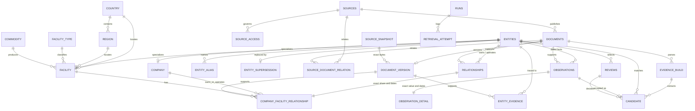
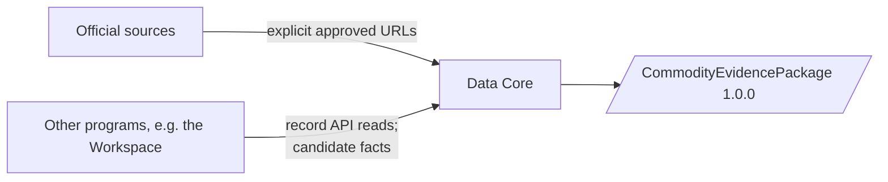

# Data diagram

The 26 Core tables (`app/models.py`, created by the baseline migration) and how they relate. Three views sit on top:
`capacity_observation` and `status_observation` over observations, `facility_alias` over entity_alias. `audit` records
who changed what and when; it refers to records by ID only.

## Around the Core

Other programs keep Core IDs and read details through the API ([CONTRACT.md](CONTRACT.md)); the Core has no code that
refers to them. Licensed lead feeds and their saved responses are not Core data.
